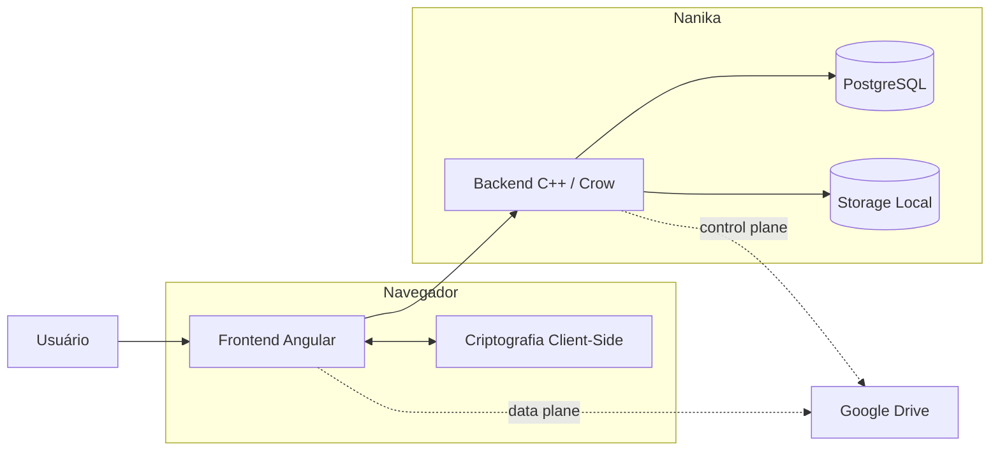

# Arquitetura

A arquitetura do Nanika separa a aplicação em três responsabilidades principais:

* **frontend**, responsável pela interface, estado de runtime e criptografia client-side;
* **backend**, responsável pela API, autenticação, autorização e coordenação dos storages;
* **persistência**, composta pelo PostgreSQL, storage Local e providers externos.



O navegador mantém as operações necessárias para transformar plaintext em ciphertext e vice-versa. O backend administra identidade, estado persistente e acesso aos recursos sem precisar das chaves utilizadas para descriptografar os arquivos do Vault.

## Documentos

### [Visão Geral](visao-geral.md)

Apresenta a arquitetura completa em alto nível e a relação entre:

* navegador;
* frontend;
* backend;
* PostgreSQL;
* storage Local;
* Google Drive;
* infraestrutura de deployment.

É o melhor ponto de partida para entender o sistema.

---

### [Frontend](frontend.md)

Explica a arquitetura da aplicação Angular, incluindo:

* inicialização e rotas;
* estado com Signals;
* autenticação e sessão;
* Vault e criptografia client-side;
* uploads e downloads;
* providers de storage;
* streaming e processamento de mídia;
* Web Workers.

---

### [Backend](backend.md)

Descreve a aplicação C++ / Crow e suas principais responsabilidades:

* inicialização;
* API e autenticação;
* PostgreSQL;
* storage Local;
* Google Drive;
* Garbage Collector;
* rate limiting;
* concorrência;
* lifecycle do processo.

---

### [Deployment](deployment.md)

Documenta como os componentes são executados e expostos:

* Docker Compose;
* containers frontend, backend e PostgreSQL;
* Nginx;
* Cloudflare Tunnel;
* hostname dedicado de upload;
* redes e portas;
* persistência;
* diferenças entre deployment e desenvolvimento.

---

### [Fronteiras de Confiança](trust-boundaries.md)

Explica quem consegue observar ou possuir cada classe de dado no sistema.

Inclui as fronteiras entre:

* navegador e backend;
* backend e PostgreSQL;
* backend e storage Local;
* navegador e Google Drive;
* backend e Google APIs;
* Public Share;
* serviços externos.

Também documenta quais informações permanecem client-side e quais metadados continuam visíveis ao servidor.

---

## Mapa da Arquitetura

```text
Usuário
   │
   ▼
Frontend Angular
   │
   ├── Crypto Client-Side
   │       │
   │       └── Vault Key / FDKs
   │
   ├──────────────► Backend Crow
   │                   │
   │                   ├──► PostgreSQL
   │                   │
   │                   ├──► Storage Local
   │                   │
   │                   └──► Google APIs
   │
   └═══════════════════► Google Drive
           ciphertext
```

A separação central pode ser resumida como:

```text
Interface + Crypto
       │
       ▼
    Frontend

Controle + Estado
       │
       ▼
     Backend

Persistência
       │
       ├── PostgreSQL
       ├── Storage Local
       └── Google Drive
```

Cada documento desta seção aprofunda uma dessas fronteiras sem duplicar os protocolos e responsabilidades das demais.
