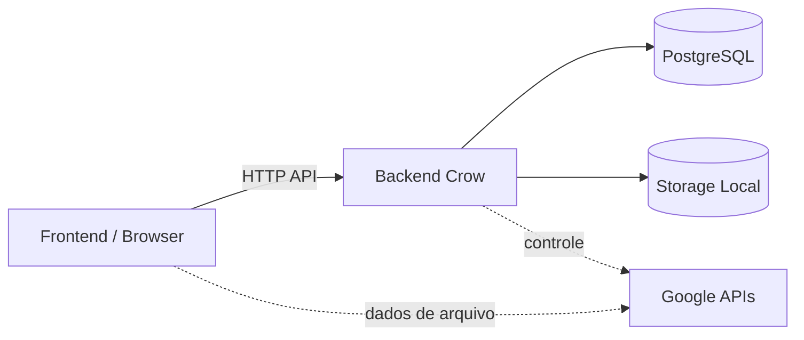
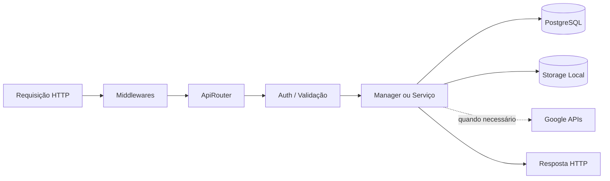
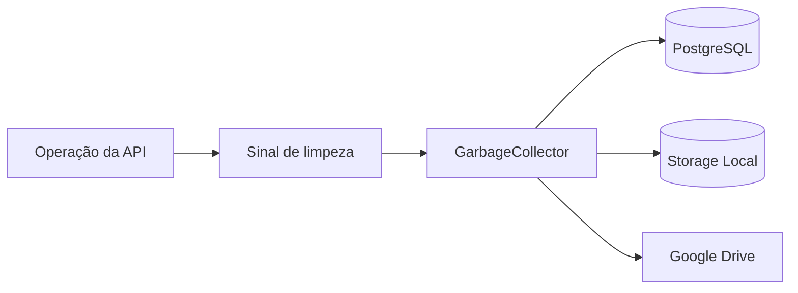

# Arquitetura do Backend

## Status documental

Esta página descreve as responsabilidades do backend presentes no repositório. Os contratos executáveis de autorização, persistência e rede permanecem nos respectivos handlers e testes.

## Fontes de autoridade no repositório

- `backend/CMakeLists.txt`: composição dos targets de produção e de teste.
- `backend/src/main.cpp`: inicialização do servidor.
- `backend/src/controllers/ApiRouter.cpp`: registro das rotas HTTP.

## Fora do escopo

Credenciais, estado de bancos de dados e resultados dos targets experimentais AP-06 não fazem parte desta descrição arquitetural de produção.

O backend do Nanika é uma aplicação **C++17** baseada em **Crow**. Ele expõe a API HTTP, autentica e autoriza operações, mantém o estado persistente da aplicação e coordena os storages utilizados pelo sistema.

A criptografia dos arquivos do Vault permanece no cliente. O backend trabalha principalmente com identidade, metadados, ciphertext e estado operacional.

## Visão Geral



O backend é a autoridade central da API e do storage Local.

No Google Drive, as responsabilidades são divididas: o backend administra a integração e suas credenciais, enquanto os fluxos suportados podem transferir os bytes dos arquivos diretamente entre navegador e Google.

---

## Inicialização

O processo começa em `backend/src/main.cpp`.

A inicialização segue esta sequência:

```text
libsodium / OpenSSL
        ↓
Configuração
        ↓
DatabasePool
        ↓
DatabaseMigration
        ↓
Serviços e Managers
        ↓
GarbageCollector
        ↓
Middlewares Crow
        ↓
ApiRouter
        ↓
Servidor HTTP
```

Primeiro são inicializadas as bibliotecas criptográficas utilizadas pelo processo e carregadas as configurações de ambiente.

Em seguida, o backend cria o pool de conexões PostgreSQL e executa as migrations necessárias. Se o schema não puder ser inicializado corretamente, o servidor encerra antes de começar a aceitar requisições.

Depois são construídos os componentes principais:

* `AuthService`;
* `FolderManager`;
* `FileManager`;
* `FileChunker`;
* `GoogleDriveService`;
* `GarbageCollector`.

Por fim, a aplicação Crow é criada com seus middlewares, as rotas são registradas pelo `ApiRouter` e o servidor inicia em modo multithreaded.

---

## Componentes Principais

| Componente             | Responsabilidade                                                |
| ---------------------- | --------------------------------------------------------------- |
| `ApiRouter`            | define as rotas HTTP e conecta requests aos serviços do backend |
| `AuthService`          | autenticação, JWTs, sessões e identidade                        |
| `DatabasePool`         | gerencia conexões com PostgreSQL                                |
| `DatabaseMigration`    | cria e valida o schema necessário à aplicação                   |
| `FileManager`          | gerencia metadados e lifecycle persistente dos arquivos         |
| `FolderManager`        | gerencia estrutura e operações persistentes de pastas           |
| `FileChunker`          | manipula os bytes do storage Local                              |
| `GoogleDriveService`   | controla a integração com contas Google Drive                   |
| `GarbageCollector`     | processa limpeza, deleções pendentes e reconciliações           |
| `RateLimitMiddleware`  | aplica limites e bloqueios relacionados a requisições           |
| `CustomCorsMiddleware` | controla as origens HTTP aceitas pelo backend                   |

Esses componentes compartilham dependências quando necessário, sem exigir uma camada intermediária única para todas as operações.

---

## Ciclo de uma Requisição

Uma requisição típica passa pelos middlewares do Crow antes de chegar à rota correspondente.



Nem todas as rotas percorrem todas essas etapas.

Endpoints públicos, autenticação, arquivos, pastas, Google Drive e compartilhamentos possuem necessidades diferentes, mas o `ApiRouter` permanece como ponto de entrada da API.

---

## Autenticação e Autorização

O backend é responsável por validar a identidade e determinar se uma operação pode ser executada.

Nos endpoints protegidos, o `ApiRouter` autentica a requisição antes de acessar os recursos associados ao usuário.

O estado de autenticação envolve:

* usuários persistidos;
* hashes de senha;
* JWTs;
* JTIs;
* sessões;
* versionamento utilizado para invalidação;
* cookies HttpOnly usados na continuidade da sessão.

```text
Request
   │
   ▼
JWT / Sessão
   │
   ▼
AuthService
   │
   ▼
user_id
   │
   ▼
Operação autorizada
```

A autenticação da conta é uma responsabilidade server-side e é separada da criptografia client-side dos arquivos do Vault.

---

## PostgreSQL

O PostgreSQL mantém o estado relacional da aplicação.

```text
Backend
   │
   ▼
DatabasePool
   │
   ▼
PostgreSQL
```

Entre os estados persistidos estão:

* usuários;
* sessões;
* arquivos;
* pastas;
* compartilhamentos;
* contas de storage externo;
* uploads;
* Storage Moves;
* filas de cleanup;
* rate limiting persistente;
* metadados necessários ao lifecycle das operações.

Os managers acessam o banco através do `DatabasePool`.

O navegador nunca acessa PostgreSQL diretamente.

---

## Storage Local

O `FileChunker` implementa o acesso físico ao storage Local.

Ele possui operações para:

* escrever chunks;
* ler arquivos completos;
* ler intervalos de bytes;
* consultar tamanho;
* remover arquivos;
* manipular artefatos temporários;
* promover ou reverter arquivos durante Storage Move;
* identificar e remover artefatos órfãos.

Os arquivos são armazenados utilizando IDs internos:

```text
storage/
├── <file_id>.dat
├── <file_id>.proxy.dat
└── storage-moves/
    └── artefatos temporários
```

O filename original do usuário não é utilizado como nome físico do arquivo.

```text
Frontend
   │
   │ bytes armazenados
   ▼
Backend
   │
   ▼
FileChunker
   │
   ▼
Filesystem
```

Para arquivos do Vault, esses bytes já chegam cifrados pelo cliente.

---

## Google Drive

`GoogleDriveService` implementa o **control plane** da integração Google Drive.

Suas responsabilidades incluem:

* vincular contas;
* validar o fluxo OAuth;
* criar e localizar a pasta usada pelo Nanika;
* armazenar informações das contas vinculadas;
* renovar access tokens;
* fornecer capabilities temporárias ao frontend;
* consultar quota;
* criar sessões de upload;
* localizar arquivos externos;
* remover objetos;
* coordenar unlink e cleanup.

```text
                     Control Plane

Frontend ─────► Backend ─────► Google APIs
                  │
                  ▼
          GoogleDriveService


                      Data Plane

Frontend ═══════════════════► Google Drive
             arquivo
```

O refresh token retornado pelo Google é cifrado antes de ser persistido no PostgreSQL.

Quando necessário, o backend recupera esse valor, solicita um novo access token e mantém tokens temporários em memória para reduzir renovações desnecessárias.

Essas credenciais fornecem autoridade sobre o provider Google, mas são independentes das chaves utilizadas para descriptografar os arquivos do Vault.

---

## Garbage Collector

O `GarbageCollector` executa trabalhos de manutenção que não precisam bloquear a requisição que originou uma mudança.

Ele possui acesso a:

```text
DatabasePool
FileChunker
GoogleDriveService
```

e processa operações como:

* arquivos órfãos;
* deleções físicas pendentes;
* deleções externas pendentes;
* reconciliações de Storage Move;
* estados que precisam convergir após operações parcialmente concluídas.

O processo executa uma limpeza durante a inicialização e mantém uma thread dedicada para ciclos posteriores.



Além das solicitações explícitas, o processo pode iniciar ciclos periódicos de manutenção.

Falhas individuais de cleanup são persistidas ou mantidas pendentes para novas tentativas conforme o tipo de operação, em vez de exigir que toda limpeza física aconteça dentro da requisição original.

---

## Rate Limiting

`RateLimitMiddleware` executa antes dos handlers da aplicação e aplica limites por cliente.

O middleware mantém estado temporário em memória e também utiliza PostgreSQL para bloqueios que precisam sobreviver ao processo.

```text
Request
   │
   ▼
Client IP
   │
   ▼
RateLimitMiddleware
   │
   ├── permitido ──► ApiRouter
   │
   └── limitado ───► HTTP 429 / bloqueio
```

Rotas de autenticação possuem limites próprios e podem resultar em bloqueios persistidos quando o comportamento excede os limites definidos.

Quando o deployment está configurado para confiar em headers de proxy, a resolução do IP utiliza essa configuração explicitamente.

---

## Concorrência

O Crow é executado em modo multithreaded, portanto múltiplas requisições podem alcançar o backend simultaneamente.

A consistência não depende de uma única thread global. Diferentes operações utilizam mecanismos adequados à sua responsabilidade, incluindo:

* transações PostgreSQL;
* locks de linha;
* advisory locks;
* locks internos de serviços;
* identificação de operações concorrentes;
* filas persistentes;
* sincronização de acesso ao filesystem.

```text
Request A ──┐
Request B ──┼──► Backend multithreaded ──► recursos compartilhados
Request C ──┘
```

O próprio `FileChunker`, por exemplo, protege operações concorrentes sobre arquivos utilizando locks particionados, enquanto operações persistentes utilizam a autoridade transacional do PostgreSQL.

---

## Encerramento

Quando o servidor é encerrado, o processo libera seus recursos de forma ordenada:

```text
Servidor encerra
      │
      ▼
Sinaliza Garbage Collector
      │
      ▼
Aguarda thread do GC
      │
      ▼
Fecha DatabasePool
      │
      ▼
Libera recursos do processo
```

Isso evita abandonar a thread de manutenção ou conexões do pool durante o teardown.

---

## Resumo

A arquitetura do backend pode ser resumida em três responsabilidades principais:

```text
                         Backend
                            │
            ┌───────────────┼────────────────┐
            │               │                │
            ▼               ▼                ▼
      API / Auth       Persistência      Storage Control
            │               │                │
            ▼               ▼                ▼
       ApiRouter        PostgreSQL      Local / Google
```

O backend controla **quem pode executar uma operação, qual estado ela produz e onde os dados são armazenados**.

A criptografia que protege o conteúdo dos arquivos permanece uma responsabilidade do cliente, permitindo que o servidor coordene armazenamento e lifecycle sem precisar das chaves que recuperam o plaintext.
