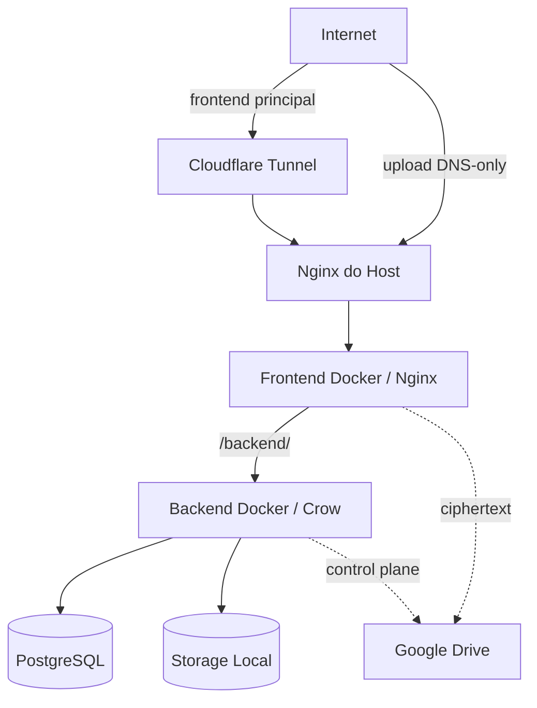

# Arquitetura de Deployment

O deployment do Nanika utiliza **Docker Compose** para executar frontend, backend e PostgreSQL em uma rede privada, enquanto um **Nginx no host** atua como ponto de entrada público da aplicação.

Frontend e backend são publicados apenas no loopback da máquina. O PostgreSQL não possui porta pública no deployment principal.

## Visão Geral



O Nginx do host é o ingresso público. Os containers da aplicação permanecem atrás dessa fronteira.

---

## Serviços Docker

O Compose principal executa três serviços:

| Serviço       | Responsabilidade                                    |
| ------------- | --------------------------------------------------- |
| `frontend`    | serve o build Angular de produção e encaminha a API |
| `backend`     | executa a aplicação C++ / Crow                      |
| `postgres-db` | mantém o estado relacional persistente              |

Os três serviços compartilham a rede Docker `nanika_network`.

```text id="98jnds"
nanika_network
│
├── frontend
│      │
│      └── backend:8080
│
├── backend
│      │
│      └── postgres-db:5432
│
└── postgres-db
```

Os nomes dos serviços funcionam como endereços internos da rede Docker, evitando que a comunicação entre containers dependa das portas publicadas no host.

---

## Frontend

O frontend utiliza um build Docker em dois estágios.

```text id="x99wax"
Node.js
   │
   │ npm run build --configuration production
   ▼
Angular Build
   │
   ▼
Nginx
   │
   ▼
Frontend Docker
```

O estágio de build utiliza Node.js para compilar a aplicação Angular.

O resultado é copiado para uma imagem Nginx, que serve os arquivos estáticos na porta `80` do container.

No host, o Compose publica essa porta somente em loopback:

```text id="x0p9m0"
127.0.0.1:6742
        │
        ▼
Frontend Docker :80
```

A porta externa pode ser configurada por `FRONTEND_PORT`, utilizando `6742` como valor padrão.

---

## Proxy da API

O Nginx existente dentro do container frontend possui duas responsabilidades:

1. servir a SPA Angular;
2. encaminhar requisições `/backend/` para o backend.

```text id="d3jhej"
Browser
   │
   ▼
Frontend Nginx
   │
   ├── / ─────────────► Angular
   │
   └── /backend/ ─────► backend:8080
```

O backend não precisa ser exposto publicamente para que a aplicação Angular consiga acessar a API.

A comunicação entre frontend e backend utiliza a rede Docker.

O Nginx do host e o proxy interno possuem um ceiling padrão de body HTTP bruto
de **16 MiB**. Ambos usam uma exceção exata de **64 MiB** para
`/backend/folders/batch-create`; o proxy interno entrega `/folders/batch-create`
ao Crow. O backend concede esse budget maior somente ao **POST** dessa rota.
O produtor oficial envia a árvore inteira (até 1000 pastas) em um único request,
preservando a transação atômica. Representações JSON artificialmente expandidas
podem exceder o envelope bruto mesmo quando os campos decoded cabem nos seus
limites semânticos. O chunk Local mantém seu limite de 4 MiB.

Na aplicação, CORS roda antes do guard de body e RateLimit depois dele. O guard
usa o tamanho real de `req.body`, independente de `Content-Length`, e rejeita
oversized requests com 413 antes dos handlers e side effects. Crow já materializou
o body nesse ponto: essa camada não protege a alocação inicial do parser.
A proteção anterior ao Crow pertence aos dois Nginx finitos. Acesso direto ao
Crow em loopback ainda pode materializar bodies grandes, mas não alcança os
side effects da aplicação acima do budget; a porta backend não é ingresso público.

---

## Backend

O backend possui seu próprio container de runtime.

Durante o build:

```text id="aajd9i"
Ubuntu Builder
      │
      ├── CMake
      ├── C++17
      └── dependências nativas
             │
             ▼
       savebox_server
             │
             ▼
      Runtime Ubuntu
```

A imagem final contém apenas o executável e as dependências necessárias à execução.

O backend escuta na porta `8080`.

No host, essa porta também é publicada somente em loopback:

```text id="4h03gx"
127.0.0.1:8080
        │
        ▼
Backend Docker :8080
```

Essa publicação permite administração e integração local sem transformar a porta do Crow em um ingresso público da aplicação.

---

## PostgreSQL

O PostgreSQL utiliza a imagem `postgres:15-alpine` e permanece exclusivamente na rede Docker no deployment principal.

```text id="sd1wsu"
Backend Docker
      │
      │ postgres-db:5432
      ▼
PostgreSQL
```

Não existe mapping equivalente a:

```text id="9q75a8"
0.0.0.0:5432
```

nem a uma porta PostgreSQL em loopback no Compose principal.

O banco é alcançado diretamente pelo backend utilizando:

```text id="oxskdz"
DB_HOST=postgres-db
DB_PORT=5432
```

O estado físico do PostgreSQL é persistido no volume Docker:

```text id="981270"
pg_data
   │
   ▼
/var/lib/postgresql/data
```

Assim, recriar o container não implica recriar o banco.

---

## Storage Local

Os arquivos do provider Local são persistidos fora do filesystem efêmero do container backend através de um bind mount:

```text id="9j5j7i"
Host
./nanika_storage
        │
        ▼
Backend Docker
/app/nanika_storage
```

O backend recebe:

```text id="9m8ph6"
NANIKA_STORAGE_PATH=/app/nanika_storage/
```

e utiliza esse diretório para os blobs e artefatos administrados pelo `FileChunker`.

A persistência Local, portanto, possui lifecycle independente do container.

---

## Nginx do Host

O Nginx instalado no host é a fronteira entre a Internet e os serviços publicados no loopback.

```text id="98fitg"
Internet
   │
   ▼
Nginx do Host
   │
   ▼
127.0.0.1:6742
   │
   ▼
Frontend Docker
```

Ele recebe atualmente os hostnames:

```text id="sjui9i"
nanika.lvinik.app
upload.nanika.lvinik.app
```

e encaminha ambos para o frontend Docker.

O frontend Nginx então decide se a requisição representa:

```text id="qlokqx"
interface / SPA
      │
      └──► arquivos Angular

/backend/
      │
      └──► backend:8080
```

Essa composição mantém o backend atrás de duas fronteiras de encaminhamento:

```text id="alxwn2"
Internet
   ↓
Nginx do Host
   ↓
Frontend Nginx
   ↓
Backend Crow
```

---

## Dois Caminhos de Ingresso

O deployment possui dois caminhos públicos deliberadamente diferentes.

### Frontend principal

O hostname principal pode entrar pelo Cloudflare Tunnel:

```text id="u4h7yx"
Internet
   │
   ▼
Cloudflare
   │
   ▼
cloudflared local
   │
   ▼
Nginx do Host
   │
   ▼
Frontend Docker
```

A configuração versionada do Tunnel encaminha os hostnames principais para:

```text id="qmkdzm"
http://localhost:80
```

onde está o Nginx do host.

---

### Upload

O hostname dedicado de upload não faz parte do Tunnel.

```text id="5hk5cs"
Internet
   │
   │ DNS-only
   ▼
upload.nanika.lvinik.app
   │
   ▼
Nginx do Host
   │
   ▼
Frontend Docker
   │
   │ /backend/
   ▼
Backend Docker
```

O frontend de produção utiliza esse hostname especificamente para os requests de upload:

```text id="hn3pdu"
API geral
    /backend

Upload
    https://upload.nanika.lvinik.app/backend
```

O hostname separado permite que o caminho de upload chegue diretamente ao servidor sem passar pelo Cloudflare Tunnel.

Ele **não expõe diretamente o container backend**: o request ainda atravessa o Nginx do host e o Nginx do frontend.

---

## Identidade do Cliente e Proxies

O deployment possui uma boundary explícita para headers utilizados na resolução do IP do cliente.

```text id="m0kn4k"
Cloudflare
    │
    │ CF-Connecting-IP
    ▼
cloudflared local
    │
    ▼
Nginx do Host
    │
    │ headers normalizados
    ▼
Backend
```

O Nginx confia em `CF-Connecting-IP` somente quando a conexão vem do `cloudflared` local.

O hostname de upload, por outro lado, chega diretamente da Internet e preserva o endereço da conexão recebida pelo Nginx.

Depois dessa resolução, o host normaliza os headers encaminhados à aplicação.

Isso permite que funcionalidades como rate limiting utilizem a identidade resolvida pelo proxy sem confiar arbitrariamente em headers enviados diretamente pelo cliente.

---

## Portas

A topologia principal utiliza:

| Porta    | Exposição       | Uso               |
| -------- | --------------- | ----------------- |
| `80/443` | pública no host | Nginx de ingresso |
| `6742`   | `127.0.0.1`     | frontend Docker   |
| `8080`   | `127.0.0.1`     | backend Docker    |
| `5432`   | rede Docker     | PostgreSQL        |

Em forma simplificada:

```text id="qpindc"
Internet
   │
 80/443
   │
   ▼
Host Nginx
   │
 6742
   │
   ▼
Frontend
   │
 8080
   │
   ▼
Backend
   │
 5432
   │
   ▼
PostgreSQL
```

Somente a primeira camada pertence ao ingresso público normal da aplicação.

---

## Persistência

Os containers podem ser recriados sem que todo o estado seja descartado.

```text id="8dehhs"
PostgreSQL Container
        │
        ▼
    pg_data


Backend Container
        │
        ▼
 ./nanika_storage
```

Existem, portanto, duas formas principais de persistência no deployment:

* volume Docker para PostgreSQL;
* bind mount do host para o storage Local.

O restante dos containers pode ser reconstruído a partir das imagens e configurações versionadas.

---

## Configuração

Segredos e parâmetros variáveis são fornecidos ao Compose por ambiente.

O backend recebe configurações para áreas como:

* PostgreSQL;
* JWT;
* password pepper;
* e-mail;
* Google OAuth;
* Imgur;
* CORS;
* storage Local;
* confiança em proxy.

```text id="c9xx01"
.env / ambiente
      │
      ▼
Docker Compose
      │
      ├──► PostgreSQL
      │
      └──► Backend
```

Os valores dessas credenciais não fazem parte das imagens.

A opção `TRUST_PROXY_HEADERS` deve refletir a topologia em que o backend está executando: o deployment com Nginx possui uma boundary de proxy definida, enquanto uma execução local direta não deve assumir a mesma confiança.

---

## Deployment, Desenvolvimento e Testes

As três formas de execução possuem objetivos diferentes.

| Ambiente                   | Frontend                               | Backend                               | PostgreSQL                                 |
| -------------------------- | -------------------------------------- | ------------------------------------- | ------------------------------------------ |
| Deployment                 | build Angular servido por Nginx Docker | container Docker                      | interno ao Compose                         |
| Desenvolvimento            | Angular dev server                     | execução local ou serviço configurado | ambiente local configurado                 |
| Testes nativos com Compose | conforme o teste                       | processo de teste                     | pode receber binding exclusivo em loopback |

O frontend Docker sempre representa o **build de produção**.

Ele não é equivalente ao Angular dev server:

```text id="qva7zi"
Desenvolvimento
Angular Dev Server
      │
      └── configuração local


Deployment
Angular Production Build
      │
      ▼
Nginx Docker
```

Existe um override `docker-compose.test.yml` que pode publicar PostgreSQL em:

```text id="yuc2ok"
127.0.0.1:5433
```

para testes nativos executados no host.

Essa porta pertence exclusivamente ao ambiente de teste e não faz parte da exposição do deployment principal.

---

## Resumo

A arquitetura de deployment mantém uma separação clara entre ingresso público, serviços internos e persistência:

```text id="4iwtpd"
                       Internet
                      /        \
            Cloudflare       Upload direto
                  \            /
                   Nginx do Host
                         │
                         ▼
                  Frontend Docker
                         │
                         ▼
                   Backend Docker
                    /          \
                   ▼            ▼
             PostgreSQL    Storage Local
```

O **Nginx do host** concentra o ingresso público.

O **frontend Docker** serve a aplicação e atua como proxy interno da API.

O **backend Docker** executa a lógica server-side e coordena persistência.

O **PostgreSQL** permanece privado à rede Docker.

O **storage Local** persiste fora do lifecycle do container.

E o caminho de upload permanece separado do Cloudflare Tunnel sem expor diretamente os serviços internos.
