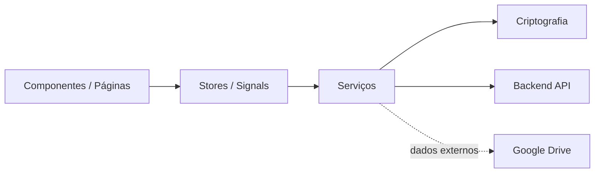
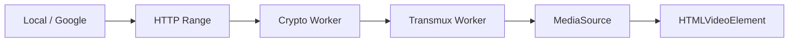

# Arquitetura do Frontend

O frontend do Nanika é uma aplicação **Angular standalone** executada no navegador.

Ele concentra a interface, o estado de runtime, a criptografia client-side e a coordenação das operações de arquivos. O backend continua responsável por autenticação, autorização, persistência e controle dos storages, enquanto o navegador mantém as chaves necessárias para recuperar o plaintext dos arquivos.

## Visão Geral



A maior parte da aplicação segue a relação:

```text
Interface
    ↓
Estado
    ↓
Serviços
    ↓
API / Crypto / Providers
```

Nem toda operação percorre todas as camadas, mas essa separação organiza as principais responsabilidades do frontend.

---

## Inicialização

A aplicação é iniciada por `main.ts` utilizando o `ApplicationConfig` definido em `app.config.ts`.

A configuração principal registra:

* Angular Router;
* `HttpClient`;
* `jwtInterceptor`;
* `errorInterceptor`;
* detecção de mudanças zoneless;
* restauração inicial da sessão;
* inicialização do tema.

```text
main.ts
   │
   ▼
ApplicationConfig
   │
   ├── Router
   ├── HttpClient
   ├── Interceptors
   ├── Zoneless
   │
   └── APP_INITIALIZER
            │
            ▼
      restoreSession()
```

Antes de a aplicação assumir que o usuário está autenticado ou não, `APP_INITIALIZER` tenta restaurar a sessão existente.

---

## Rotas

As principais superfícies da aplicação são carregadas pelo Angular Router.

```text
/
│
├── /login
├── /verify
├── /auth/callback
├── /share/:id
│
└── /drive
    ├── /home
    └── /setup
```

A área `/drive` exige uma sessão autenticada através de `authGuard`.

A página principal do Vault adiciona uma segunda boundary:

```text
/drive/home
     │
     ▼
 authGuard
     │
     ▼
 vaultGuard
```

Assim, estar autenticado e possuir o Vault desbloqueado são estados diferentes.

O compartilhamento público possui sua própria rota e não depende de uma sessão autenticada do destinatário.

---

## Organização

O frontend é dividido principalmente entre funcionalidades globais e features da aplicação.

| Área                | Responsabilidade                                   |
| ------------------- | -------------------------------------------------- |
| `core/auth`         | autenticação, sessão e guards                      |
| `core/crypto`       | chaves e operações criptográficas                  |
| `core/interceptors` | comportamento transversal das chamadas HTTP        |
| `core/state`        | estado global da aplicação                         |
| `core/theme`        | estado e inicialização visual                      |
| `features/auth`     | login, verificação e callbacks                     |
| `features/drive`    | arquivos, pastas, storages, transferências e mídia |
| `features/share`    | acesso a compartilhamentos públicos                |
| `shared`            | componentes e utilitários reutilizáveis            |

A feature `drive` concentra a maior parte da lógica funcional do cliente.

```text
features/drive
│
├── components
├── layouts
├── pages
├── services
├── state
├── storage-move
└── upload
```

---

## Estado da Aplicação

O frontend utiliza **Angular Signals** para representar estado reativo.

O estado global da aplicação é controlado por `AppStateService`.

```text
Loading
   │
   ├── sessão ausente ───────► Unauthenticated
   │
   └── sessão válida
          │
          ├── Vault ausente ─► Onboarding
          │
          └── Vault existe ──► Locked
                                  │
                                  │ unlock
                                  ▼
                               Unlocked
```

Os estados principais são:

| Estado            | Significado                                 |
| ----------------- | ------------------------------------------- |
| `Loading`         | aplicação restaurando o estado inicial      |
| `Unauthenticated` | nenhuma sessão válida                       |
| `Onboarding`      | usuário autenticado sem Vault inicializado  |
| `Locked`          | sessão válida, Vault Key ausente da memória |
| `Unlocked`        | Vault Key disponível em memória             |

Isso permite que autenticação e desbloqueio criptográfico sejam tratados separadamente.

---

## Stores da Área de Arquivos

A feature `drive` utiliza stores especializados para projetar diferentes aspectos da interface.

### `DriveStore`

`DriveStore` coordena o estado principal da área de arquivos:

* arquivos;
* quota;
* seleção;
* uploads;
* downloads;
* grupos de transferência;
* thumbnails;
* contas Google;
* Storage Move;
* estados de processamento.

```text
DriveStore
│
├── arquivos
├── quota
├── transfers
├── uploads
├── downloads
├── thumbnails
└── storage operations
```

Os objetos utilizados pela interface podem conter tanto a representação cifrada recebida da API quanto a representação descriptografada produzida localmente.

Por exemplo:

```text
encryptedName
      │
      │ decrypt
      ▼
decryptedName
```

Quando o Vault está bloqueado, a aplicação não precisa manter o nome plaintext disponível.

---

### `ComputerStore`

`ComputerStore` representa a visão dos destinos disponíveis na interface “Este Computador”.

Ele coordena:

* storage Local;
* contas Google vinculadas;
* pasta atual;
* histórico de navegação;
* navegação para trás e para frente;
* breadcrumb;
* paginação;
* preview de conteúdo.

```text
Este Computador
│
├── Local
│   └── pastas / arquivos
│
└── Google Drive
    ├── Conta A
    └── Conta B
```

A interface pode apresentar destinos diferentes de forma uniforme sem eliminar as diferenças de protocolo entre eles.

---

## Autenticação e Sessão

O frontend utiliza um JWT Bearer para chamadas autenticadas.

Durante o runtime:

```text
Backend
   │
   │ JWT
   ▼
AuthService
   │
   │ RAM
   ▼
jwtInterceptor
   │
   ▼
HTTP Request
```

O JWT acessível ao JavaScript permanece em memória.

A continuidade da sessão utiliza também um cookie **HttpOnly** emitido pelo backend.

Após recarregar a página:

```text
F5
 │
 ▼
APP_INITIALIZER
 │
 ▼
restoreSession()
 │
 │ HttpOnly cookie
 ▼
Backend
 │
 │ novo JWT
 ▼
Frontend RAM
```

Assim, o frontend não precisa persistir o Bearer JWT em `localStorage`.

---

## Criptografia Client-Side

O frontend é responsável pelas operações criptográficas dos arquivos do Vault.

A hierarquia principal é:

```text
Frase de Segurança
        │
        ▼
    Master Key
        │
        ▼
    Vault Key
        │
        ▼
       FDK
        │
        ▼
     Arquivo
```

A Master Key é derivada quando necessária e permanece transitória.

A Vault Key desbloqueada fica em memória durante o estado `Unlocked`.

Ao bloquear o Vault, sua representação em memória é sobrescrita e removida.

```text
Unlocked
   │
   │ lock
   ▼
Vault Key.fill(0)
   │
   ▼
Vault Key = null
   │
   ▼
Locked
```

Cada arquivo utiliza sua própria **FDK — File Data Key**.

As operações detalhadas do formato criptográfico são implementadas por `CryptoService` e `KasumiCryptoService`.

---

## Upload

A preparação de um arquivo acontece no navegador antes da transferência.

```text
Arquivo
   │
   ├── nome ─────► encrypt ──► encrypted_name
   │
   ├── nome ─────► hash ─────► name_hash
   │
   ├── random ────────────────► FDK
   │                              │
   │                              └── encrypt ─► encrypted_fdk
   │
   └── conteúdo + FDK
           │
           ▼
       UploadPlan
           │
           ▼
       encryptFileParts()
           │
           ▼
       frames de transporte
```

`UploadEngineService` produz um plano contendo:

* nome cifrado;
* `name_hash`;
* FDK cifrada;
* FDK de runtime;
* tamanho cifrado;
* quantidade de chunks;
* `baseNonce` e receita de metadados para recuperação contextual;
* thumbnail quando disponível.

O ciphertext é materializado incrementalmente por `encryptFileParts()` e dividido
por `frameUploadChunks()`; não há um blob cifrado inteiro no plano de upload.

---

## Upload Local

Para o provider Local, os frames cifrados são enviados ao backend em chunks de
transporte.

```text
Browser
   │
   │ frames cifrados
   ▼
chunks
   │
   ▼
Backend
   │
   ▼
Storage Local
```

O frontend acompanha os chunks já enviados e pode continuar uma transferência sem retransmitir necessariamente todas as partes concluídas.

A pausa e o cancelamento são controlados pelo estado da transferência e por `AbortSignal`.

---

## Upload Google Drive

No Google Drive, o data plane não passa pelo backend.

```text
                   controle
Browser ───────────────► Backend
                           │
                           ▼
                       Google APIs


                    frames cifrados
Browser ═══════════════════════► Google Drive
```

Depois que o backend fornece o contexto autorizado necessário, o frontend envia
os frames cifrados diretamente para:

```text
Google Drive API
```

utilizando o access token recebido para aquela operação.

Quando o Google retorna o ID do objeto criado, o frontend informa esse identificador ao backend para finalizar o estado persistente do arquivo.

---

## Download

O frontend também coordena a descriptografia durante o download.

Existem caminhos diferentes para Local e Google.

### Local

O download Local utiliza requisições parciais para obter os chunks cifrados.

```text
Storage Local
      │
      ▼
   Backend
      │
      │ HTTP Range
      ▼
   Frontend
      │
      ▼
decryptFileChunk()
      │
      ▼
   plaintext
```

Cada faixa recebida é autenticada e descriptografada no navegador antes de compor o arquivo final.

---

### Google Drive

Para arquivos Google:

```text
Google Drive
      │
      │ ciphertext
      ▼
   Frontend
      │
      ▼
 decryptFile()
      │
      ▼
   plaintext
```

O frontend solicita o objeto diretamente à API:

```text
https://www.googleapis.com/drive/v3/files/<id>?alt=media
```

utilizando um access token temporário.

O backend continua responsável pelo controle da conta e pela autorização necessária, mas não funciona como proxy geral dos bytes do arquivo.

---

## Estado das Transferências

Uploads e downloads são representados como itens de transferência.

Um item pode passar por estados como:

```text
pending
   │
   ▼
processing
   │
   ├──► paused
   │       │
   │       └──► processing
   │
   ├──► cancelling
   │       │
   │       └──► cancelled
   │
   ├──► error
   │
   └──► success
```

A interface acompanha:

* progresso;
* bytes transferidos;
* velocidade;
* ETA;
* fase atual;
* erros;
* grupos de arquivos;
* pausa;
* retomada;
* cancelamento.

Transferências múltiplas e uploads de pasta podem ser agrupados em uma visão agregada sem perder o estado individual de cada arquivo.

---

## Cancelamento e Estado Efêmero

Operações de rede utilizam `AbortController` para interromper trabalho em andamento.

```text
Transferência
     │
     ├── HTTP request
     ├── crypto state
     └── runtime buffers
            │
            ▼
         cancel()
            │
            ├── abort request
            ├── remove state
            └── wipe keys
```

Serviços de download e upload verificam se a operação ainda é atual antes de aplicar efeitos posteriores.

Material criptográfico associado a transferências canceladas é removido quando o lifecycle correspondente termina.

Em um cancelamento ambíguo de um PUT resumable Google já iniciado, o frontend
zera a FDK e entrega ao backend apenas a autoridade de limpeza necessária. O
backend/GC não recebe FDK, sessão, token ou ciphertext.

---

## Mídia e Streaming

O frontend possui pipelines específicos para previews, thumbnails, imagens e vídeo.

Para vídeo, `VideoStreamService` combina:

* HTTP Range;
* descriptografia por chunks;
* Web Workers;
* MP4 parsing/transmux;
* `MediaSource`;
* `SourceBuffer`.



Os bytes recebidos permanecem cifrados até chegar ao pipeline de criptografia do navegador.

O resultado descriptografado é processado localmente para reprodução.

---

## Buffering de Vídeo

O player não precisa baixar o arquivo inteiro antes de reproduzir.

Ele mantém uma janela de conteúdo próxima ao playhead:

```text
       descartado        mantido             futuro
           │                │                   │
───────────┼────────────────┼───────────────────┼────► tempo
           │                ▲                   │
                     currentTime
```

O serviço:

* carrega dados sob demanda;
* mantém conteúdo à frente do ponto atual;
* remove ranges antigos do `SourceBuffer`;
* suporta seek;
* cancela requests obsoletos;
* descarta resultados pertencentes a gerações antigas.

Essa abordagem limita o uso de memória e permite streaming de arquivos cifrados sem mover a descriptografia para o servidor.

---

## Workers

Operações pesadas de mídia e criptografia podem ser retiradas da thread principal através de Web Workers.

```text
Main Thread
    │
    ├── UI
    ├── Signals
    └── Orquestração
          │
          ├──► Crypto Worker
          │
          └──► Transmux Worker
```

Isso evita que processamento intensivo de chunks bloqueie diretamente a interface.

Os workers recebem apenas o material necessário à operação corrente e participam do lifecycle da sessão de mídia correspondente.

---

## Google Drive

Além dos data paths diretos, o frontend também coordena a experiência de vinculação das contas Google.

```text
Frontend
   │
   │ OAuth authorization
   ▼
Google
   │
   │ code + state
   ▼
Frontend Callback
   │
   ▼
Backend
```

Depois de vinculada, a conta aparece como um dos destinos disponíveis da aplicação.

O frontend pode então obter contexto temporário para:

* upload;
* download;
* streaming;
* visualização;
* navegação por storage.

As credenciais persistentes e o refresh OAuth permanecem sob responsabilidade do backend.

---

## Compartilhamento Público

A rota:

```text
/share/:id
```

possui uma superfície separada da área autenticada do drive.

O navegador destinatário recebe o identificador do compartilhamento pela URL e a FDK pelo fragmento:

```text
/share/<id>#<FDK>
```

A chave permanece no cliente e é utilizada para:

* descriptografar o nome;
* descriptografar o arquivo recebido.

```text
share-id ──────► Backend ──────► ciphertext
                                      │
FDK no fragmento ─────────────────────┤
                                      ▼
                                  Browser
                                      │
                                      ▼
                                  plaintext
```

O frontend público, portanto, também participa da boundary criptográfica sem exigir que o backend receba a FDK do compartilhamento.

---

## Ambiente de Desenvolvimento e Produção

O frontend possui configurações diferentes para desenvolvimento e produção.

### Desenvolvimento

```text
Angular Dev Server
       │
       ├── API ───────► http://localhost:8080
       │
       └── Upload ────► http://localhost:8080
```

Os logs internos de crypto, upload e mídia podem ser habilitados nessa configuração.

### Produção

```text
Frontend
   │
   ├── API geral ───► /backend
   │
   └── Upload ──────► upload.nanika.lvinik.app/backend
```

O build de produção é servido pelo Nginx do container.

O hostname dedicado de upload altera apenas o caminho de transporte até a infraestrutura Nanika; a lógica de criptografia continua acontecendo no navegador.

---

## Resumo

A arquitetura do frontend pode ser resumida em quatro responsabilidades principais:

```text
                          Frontend
                             │
             ┌───────────────┼────────────────┐
             │               │                │
             ▼               ▼                ▼
        Interface          Estado         Operações
                             │                │
                             │         ┌──────┴──────┐
                             │         ▼             ▼
                             │       Crypto       Rede
                             │                       │
                             │               ┌───────┴───────┐
                             │               ▼               ▼
                             │            Backend         Providers
```

O frontend não é apenas uma camada de apresentação.

Ele é também a zona onde:

* o Vault é desbloqueado;
* as chaves client-side permanecem durante o uso;
* arquivos são cifrados antes do upload;
* ciphertext é descriptografado após o download;
* transferências são coordenadas;
* mídia é processada;
* Google Drive pode ser acessado diretamente para o data plane.

O backend continua responsável pelo controle e persistência da aplicação, enquanto o navegador mantém as operações necessárias para transformar ciphertext em conteúdo utilizável pelo usuário.
