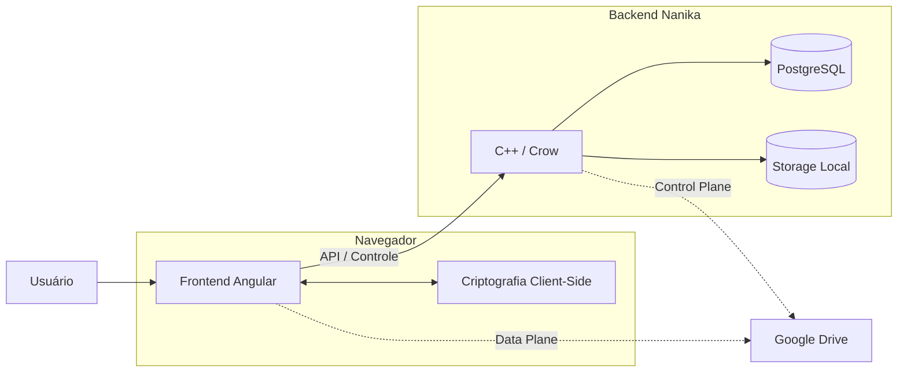
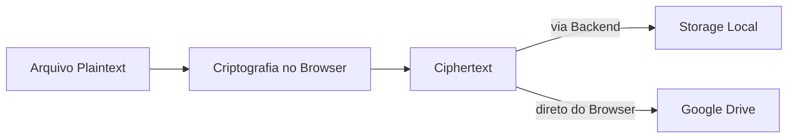
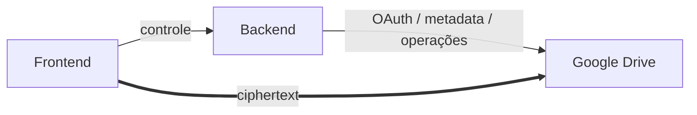
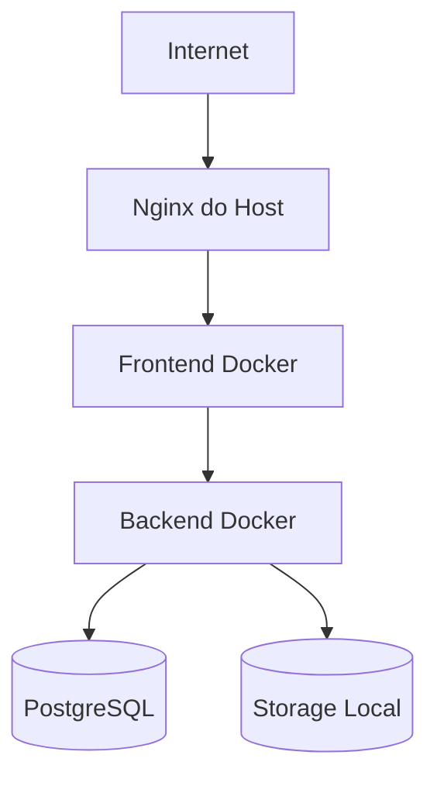

# Visão Geral da Arquitetura

O Nanika é um agregador de armazenamento em nuvem com **criptografia ponta a ponta**, backend próprio e suporte a múltiplos destinos de storage.

A arquitetura combina:

* frontend Angular executado no navegador;
* backend C++17 baseado em Crow;
* PostgreSQL;
* storage Local;
* Google Drive como provider externo;
* Docker e Nginx no deployment.

A separação central do sistema é entre **dados e criptografia no cliente** e **controle e persistência no servidor**.

## Arquitetura de Alto Nível



O frontend é responsável por transformar arquivos entre plaintext e ciphertext.

O backend coordena autenticação, autorização, metadados, lifecycle e storages sem precisar das chaves utilizadas para recuperar o plaintext dos arquivos do Vault.

---

## Componentes

| Componente         | Responsabilidade                                                       |
| ------------------ | ---------------------------------------------------------------------- |
| **Frontend**       | interface, estado de runtime, criptografia, uploads, downloads e mídia |
| **Backend**        | API, autenticação, autorização e coordenação das operações             |
| **PostgreSQL**     | estado relacional e metadados persistentes                             |
| **Storage Local**  | persistência de arquivos cifrados controlada pelo backend              |
| **Google Drive**   | armazenamento externo de arquivos cifrados                             |
| **Nginx / Docker** | execução, isolamento e encaminhamento de tráfego                       |

Cada componente possui uma função diferente, mas eles formam uma única unidade lógica para o usuário.

```text
                    Nanika

     ┌─────────────────────────────┐
     │          Frontend           │
     │  UI + Estado + Criptografia │
     └──────────────┬──────────────┘
                    │
                    ▼
     ┌─────────────────────────────┐
     │           Backend           │
     │   API + Controle + Estado   │
     └───────┬───────────┬─────────┘
             │           │
             ▼           ▼
        PostgreSQL     Storage Local

     Frontend ═══════════► Google Drive
               ciphertext
```

---

## Frontend e Backend

Frontend e backend possuem responsabilidades complementares.

```text
Frontend
│
├── interface
├── estado
├── Vault
├── criptografia
├── transferências
└── processamento de mídia


Backend
│
├── autenticação
├── autorização
├── API
├── metadados
├── persistência
├── storage Local
└── integração de providers
```

O frontend não acessa PostgreSQL ou o filesystem Local diretamente.

Essas operações passam pela API:

```text
Frontend
   │
   ▼
Backend
   │
   ├──► PostgreSQL
   │
   └──► Storage Local
```

No Google Drive, parte dessa relação muda porque os bytes dos arquivos podem ser transferidos diretamente pelo navegador.

---

## Caminho de um Arquivo

Antes de ser armazenado, um arquivo é preparado no navegador.



Em alto nível:

```text
arquivo plaintext
       │
       ▼
    Navegador
       │
       ├── gera FDK
       ├── cifra nome
       ├── cifra FDK
       └── cifra conteúdo
              │
              ▼
          ciphertext
              │
        ┌─────┴─────┐
        ▼           ▼
      Local       Google
```

O destino muda, mas a criptografia continua acontecendo antes da persistência.

---

## Storage Local

No provider Local, os bytes cifrados são enviados para o backend.

```text
Navegador
    │
    │ ciphertext
    ▼
 Backend
    │
    ▼
FileChunker
    │
    ▼
Storage Local
```

O backend administra:

* escrita;
* leitura;
* Range;
* remoção;
* artefatos temporários;
* operações relacionadas ao lifecycle físico.

No download, o backend devolve os bytes armazenados e a descriptografia ocorre novamente no navegador.

```text
Storage Local
      │
      ▼
   Backend
      │
      │ ciphertext
      ▼
   Navegador
      │
      ▼
   plaintext
```

---

## Google Drive

Google Drive possui uma divisão entre **control plane** e **data plane**.



### Control Plane

O backend administra aspectos como:

* contas vinculadas;
* OAuth;
* tokens;
* quota;
* identificadores externos;
* lifecycle da integração.

### Data Plane

Para operações suportadas, os bytes dos arquivos trafegam diretamente entre:

```text
Navegador ↔ Google Drive
```

O backend não funciona como proxy geral dos arquivos armazenados no Google.

---

## Estado Persistente

O PostgreSQL mantém a autoridade sobre o estado relacional da aplicação.

```text
                     PostgreSQL
                         │
        ┌────────────────┼────────────────┐
        │                │                │
        ▼                ▼                ▼
     Usuários        Arquivos          Storages
     Sessões         Pastas            Operações
                     Shares            Lifecycle
```

O banco conhece a estrutura necessária para administrar o sistema, incluindo metadados cifrados e informações operacionais.

Ele não armazena as chaves plaintext necessárias para descriptografar os arquivos do Vault.

---

## Vault e Criptografia

O Vault cria uma separação entre uma sessão autenticada e uma sessão capaz de acessar o conteúdo dos arquivos.

```text
Usuário autenticado
        │
        ▼
      Locked
        │
        │ frase de segurança
        ▼
    Master Key
        │
        ▼
    Vault Key
        │
        ▼
     Unlocked
        │
        ▼
       FDKs
        │
        ▼
      Arquivos
```

A Vault Key desbloqueada permanece no navegador durante o uso do Vault.

Cada arquivo utiliza uma FDK própria para suas operações criptográficas.

Assim, autenticação server-side e acesso criptográfico aos arquivos são responsabilidades diferentes.

---

## Compartilhamento Público

O Nanika também possui um fluxo de compartilhamento público para arquivos Local.

```text
Proprietário
     │
     ▼
  share-id + FDK
     │
     ▼
Link de compartilhamento
     │
     ▼
Destinatário
     │
     ├── share-id ──► Backend ──► ciphertext
     │
     └── FDK ────────────────────┐
                                 ▼
                             Navegador
                                 │
                                 ▼
                             plaintext
```

O backend entrega o arquivo cifrado, enquanto a chave utilizada pelo destinatário permanece no fragmento do link.

---

## Deployment

Em produção, os componentes principais são executados com Docker Compose.



O frontend de produção é um build Angular servido por Nginx.

O backend e o frontend são publicados somente no loopback do host, enquanto o PostgreSQL permanece na rede interna do Compose.

O Nginx do host concentra o ingresso público.

O deployment possui dois caminhos externos principais:

```text
Frontend principal
Internet
   ↓
Cloudflare Tunnel
   ↓
Nginx


Upload
Internet
   ↓
DNS-only
   ↓
Nginx
```

Depois do ingresso, ambos convergem para a mesma aplicação.

---

## Fronteiras de Confiança

A arquitetura não considera todos os componentes igualmente confiáveis para todos os tipos de informação.

De forma simplificada:

```text
Plaintext + Chaves
        │
        ▼
     Browser


Controle + Metadata
        │
        ▼
     Backend


Estado Persistente
        │
        ▼
 PostgreSQL / Storage


Ciphertext Externo
        │
        ▼
   Google Drive
```

Isso não significa que o backend seja cego a toda informação.

Ele conhece identidade, estrutura, tamanhos, providers e outros metadados necessários para operar o serviço.

A separação criptográfica se concentra principalmente no conteúdo dos arquivos e nas chaves necessárias para recuperá-lo.

Para uma descrição detalhada, consulte [Fronteiras de Confiança](trust-boundaries.md).

---

## Documentação da Arquitetura

A arquitetura pode ser aprofundada pelos seguintes documentos:

* [Frontend](frontend.md) — aplicação Angular, estado, criptografia, transferências e mídia.
* [Backend](backend.md) — API, persistência, storages, serviços e concorrência.
* [Deployment](deployment.md) — Docker, Nginx, redes, portas e ingress.
* [Fronteiras de Confiança](trust-boundaries.md) — visibilidade dos dados e responsabilidades de confiança.

```text
Visão Geral
    │
    ├── Frontend
    ├── Backend
    ├── Deployment
    └── Fronteiras de Confiança
```

A visão geral apresenta como essas partes se conectam; os documentos especializados explicam como cada uma funciona internamente.
